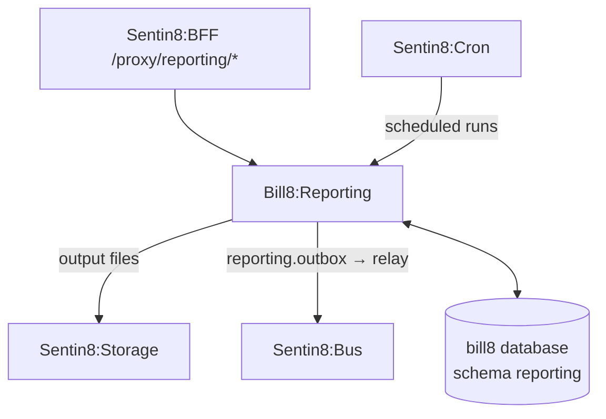

# Bill8:Reporting — Reports

Report types, report runs, and scheduled reports.

## 1. Summary

Bill8:Reporting owns the reporting surface: report types that define
a query shape, report runs that execute them, and scheduled reports that
deliver output files via Storage.

## 2. Motivation

Merchants need period-end and operational reports without building them.
Centralizing report definitions and runs keeps reporting concerns out of
domain services and gives operators a consistent output contract.

## 3. Architecture & High-Level Design

## 4. Key Traits and Data Structures

- `ReportType` — a named report definition with a versioned query shape.
- `ReportRun` — an execution of a type with a status
  (`pending` → `succeeded` / `failed`) and an output reference.

## 5. Rationale, Trade-offs, and Alternatives

- **Report runs over live queries**: a run snapshots data at a point in
  time, so a period-end report is reproducible.
- **Delegating scheduling to Sentin8:Cron** over an embedded scheduler.

## 6. Internal Implementation & Invariants

- A run is idempotent per `(env_id, report_type, period)`.
- Output files are written to Storage and referenced, never inlined.

## 7. Unresolved Questions / Future Designs

- See `DESIGN.md` §10.

---

**Design attribution:** bill8:reporting and its underlying concepts were designed by Hamid Jahanzad <Hamid@Jahanzad.com>.
